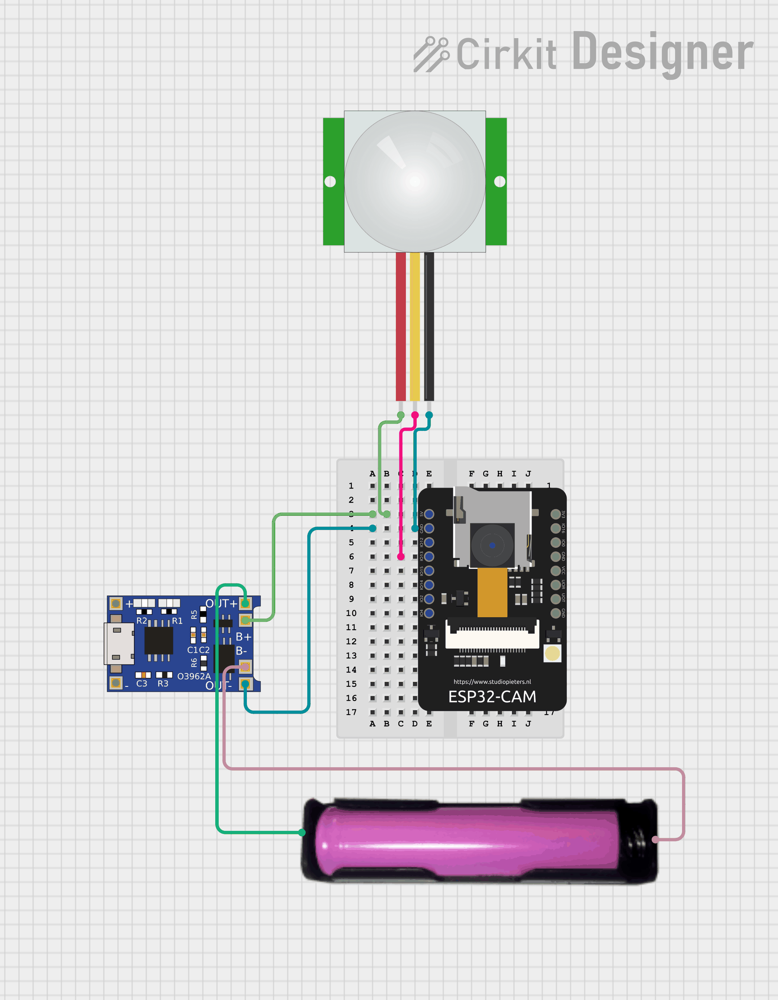

# Smart Intruder Detection System using ESP32-CAM

An ESP32-CAM and PIR-based security prototype. Motion detection triggers a camera capture, and the sketch sends the image to an authorized Telegram chat. The bot also supports a manual photo command and automatic-mode controls.

## Features

- PIR motion sensing
- ESP32-CAM image capture
- Telegram photo alerts
- `/photo`, `/auto_on`, and `/auto_off` bot commands
- Circuit diagram and product interface preview

## Hardware

- AI Thinker ESP32-CAM
- PIR motion sensor
- Suitable regulated power source
- Jumper wires and breadboard

## Software requirements

- Arduino IDE with the ESP32 Arduino core
- `UniversalTelegramBot` library
- `ArduinoJson` library
- ESP32 camera support provided by the board package

`WiFi`, `WiFiClientSecure`, and `esp_camera` are used by the sketch.

## Configuration

1. Select the correct ESP32-CAM board and camera pin mapping for your hardware.
2. Replace the Wi-Fi and Telegram placeholders in `Smart_Security_Cam_Code.ino` with local values before compiling.
3. Keep real passwords, bot tokens, and chat identifiers out of Git. Use a private local config file or environment-specific build settings for actual deployments.
4. Confirm the PIR output pin and power wiring match the circuit and your board.

## Current code status

This upload is a prototype starter sketch. The camera configuration includes an explicit `...` placeholder for the board pin map, and `TELEGRAM_CERTIFICATE_ROOT` must be defined by the installed Telegram library or project configuration. Complete those items for your exact board and library versions before compiling or flashing. No hardware run was performed as part of this repository setup.

## Circuit

## Product interface preview

The preview shows the supplied product webpage image; the webpage source is not included in this project folder.

## Repository topics

`esp32` · `esp32-cam` · `iot` · `intrusion-detection` · `telegram-bot`

